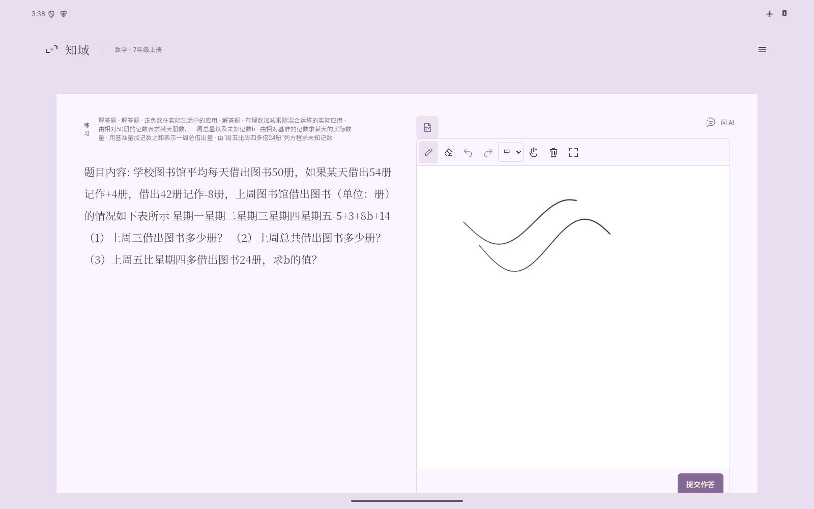

# 知域 · Android

一个离线优先的数学、物理学习应用。题库、账号和学习记录保存在设备内；AI 问答、图片评阅及主动更新题库时联网。

[下载最新版 APK](https://github.com/SpiralKernel/Zhiyu-Android/releases/latest) · [网页端原项目](https://github.com/SpiralKernel/AI-teacher)

## 功能

- 离线做题、按册次切换练习、记录题型掌握情况与复习线索。
- 文字或拍照提问，题目内即时求助；通过个人 API 连接调用模型。
- 文件、图片和 PDF 导入，经 AI 双轮审核及后端校验后纳入本地题库。
- 可收起的答题纸，支持触控笔压感、撤销、整笔擦除及草稿恢复；大题可提交手写图片评阅。平板宽屏支持双栏。
- 学习报告与 PDF 导出；五种主题、明暗模式和五档字号。
- 相册头像、拖动裁剪与缩放；可修改称呼与用户名。
- 签名题库更新，不替换本地账号和学习记录。

支持 Android 7.0 及以上的 ARM64 手机和平板。下载 `Zhiyu-0.8.1-arm64.apk` 安装；注册不需要邀请码，首次注册后可配置 AI，也可先跳过。账号仅在本机，不与网页端账号自动同步。图片评阅需要所选连接配置可用的识图模型。

本版本内置 6,901 道可练题；这不表示每题均经教师认证或覆盖全部教学要求。对话、草稿和一次 AI 评阅不会自动变成可靠的独立掌握证据。触控笔延迟及掌触效果仍需实体设备验证。



## 与网页端分开维护

本仓库从原项目的安卓版开发快照独立建立，不包含原仓库的 Git 历史。`app/` 是嵌入手机的 Python 运行时，`web/` 是 APK 内本地界面，不依赖在线网页服务。云端网页继续在原仓库维护。旧应用 ID `org.aiteacher.offline` 保留，正式 APK 沿用原签名，可覆盖安装旧版而保留数据。

## 开发与构建

需要 Python 3.12、uv、JDK 21、Android SDK 35，以及可用的网络来下载构建依赖。无需维护者的学生数据库或签名私钥：

```bash
git clone https://github.com/SpiralKernel/Zhiyu-Android.git
cd Zhiyu-Android
uv sync --python 3.12 --frozen
uv run python scripts/fetch_android_assets.py
uv run python scripts/prepare_android.py
# 设置 JAVA_HOME、ANDROID_HOME，或用 Android Studio 生成 android/local.properties。
cd android
./gradlew :app:assembleDebug
```

调试 APK 位于 `android/app/build/outputs/apk/debug/app-debug.apk`，默认仅包含 ARM64。模拟器版本使用 `./gradlew -PmobileAbi=x86_64 :app:assembleDebug`。正式版使用 `:app:assembleRelease`，需要维护者自己的 `android/signing.properties` 与签名文件；这些文件不进入 Git。自行签名的包不能覆盖维护者签名的安装，后续正式升级必须沿用同一签名。

Release 中附有已签名题库及 SHA256 固定的 Android 原生依赖 wheel。脚本先验证题库 RSA 签名和所有摘要，再准备构建缓存。手动下载全部构建附件后可运行 `uv run python scripts/fetch_android_assets.py --source-dir 附件目录`。原生依赖来源与重建说明见 [android/wheels/README.md](android/wheels/README.md)。

本地界面开发：`uv run uvicorn app.main:app --host 127.0.0.1 --port 8010`。该方式使用独立的开发数据库，不是线上网页部署。回归测试：`uv run pytest -q`；独立源码验证为 605 项通过、5 项因未附可选题源或教材 PDF 而跳过；原开发环境的安卓版回归为 608 项通过、1 项跳过。

## 目录

| 目录 | 内容 |
| --- | --- |
| `android/` | 原生 Activity、WebView、加密存储、系统选图与 Python 嵌入 |
| `app/` | 本地 API、账号隔离、题库、学情、AI 约束与报告 |
| `web/` | 包内界面、头像裁剪和答题纸 |
| `scripts/` | 构建准备、题库与标定维护工具 |
| `tests/` | 无需付费模型的回归测试 |
| `docs/` | 安卓说明及继承的课程、题库与学情设计文档 |

[安卓架构与功能说明](docs/android-offline.md) · [构建和发布](docs/android-build.md) · [题目标注规范](docs/question-annotation.md) · [学情证据规则](docs/student-memory.md)

API Key、学生数据库、照片、草稿、教材 PDF、签名私钥与本机配置不在源码仓库。题库构建附件只包含练习内容，不包含学生数据。第三方组件许可见 `web/vendor/katex/LICENSE`、`web/providers/LICENSE` 和原生 wheel 内许可证；题源说明见 [docs/question-sources.md](docs/question-sources.md)。
